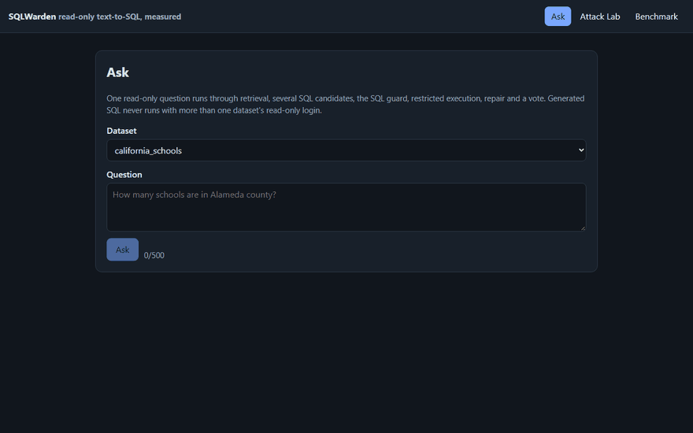
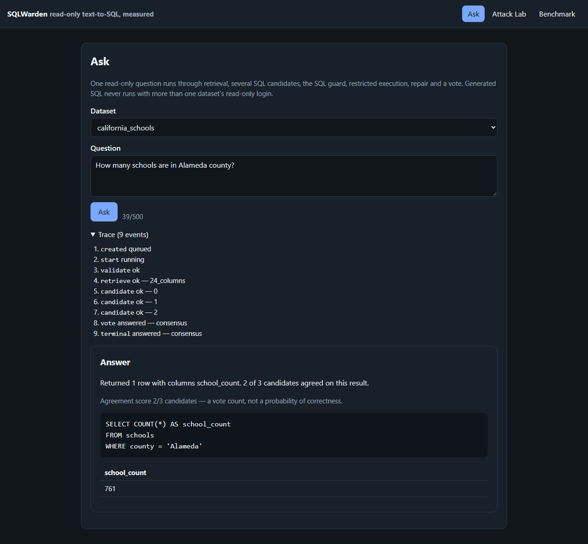
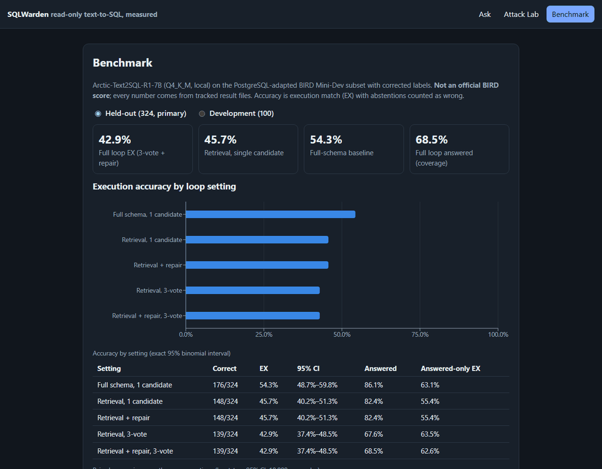
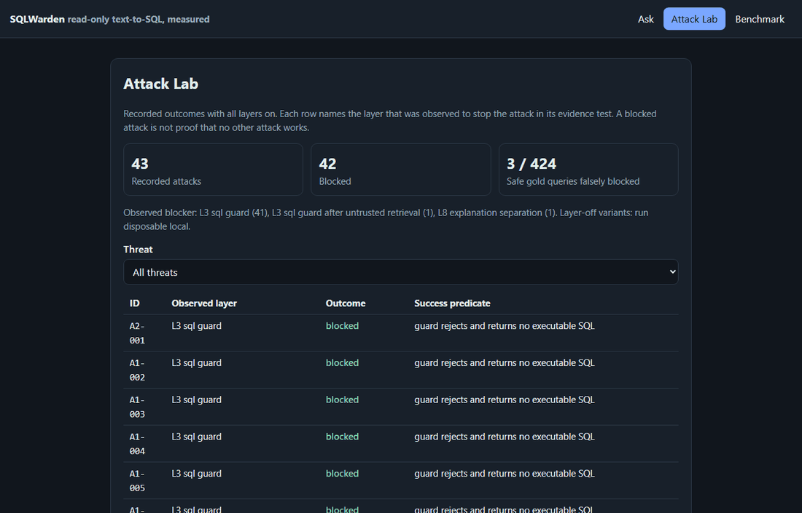

# SQLWarden

**Ask a database a question in plain English. Get an answer you can check, from an AI
that is never trusted with your data.**



*A real run on a laptop, sped up: the question goes in, three AI-written SQL queries are
checked and run safely, two agree, and the answer is 761.*

## The problem

Asking a database a question normally means writing SQL. AI models can write SQL from
plain English, but they write it well enough to be useful and badly enough to be
dangerous. They invent columns that don't exist and return confident wrong numbers.
Some text can also trick them into writing a query that deletes or leaks data. Giving
such a model direct database access is like handing a stranger the keys to your office
because they sound helpful.

SQLWarden treats the model as an untrusted SQL author. It puts hard limits around
everything the model writes, and it says "I'm not sure" when it can't be confident,
rather than guessing.

## How it works, in plain words

1. **Find the right columns.** A database can have hundreds of columns. A keyword
   search picks the 24 most relevant ones, like a librarian pulling only the right
   shelves, so the model isn't overwhelmed.
2. **Write three drafts.** A local AI model writes three separate SQL queries for the
   same question.
3. **Check every draft.** A SQL guard reads each query the way a compiler would, into
   a tree of parts, not as plain text. Only read-only `SELECT` queries made of approved
   parts get through, so anything that could change data is refused.
4. **Run it in a locked room.** Approved queries run under a login that can only read
   one dataset, with time and size limits and a cost check first. Even if the guard
   missed something, the database itself would refuse to change anything.
5. **Fix once.** If a query fails, the model gets one chance to repair it.
6. **Vote on the results.** SQLWarden compares the actual rows each query returned,
   not the SQL text. If at least two agree, that's the answer. If they disagree, it asks
   you one clarifying question or abstains.

## The tech, explained simply

| Piece | What it is | Why it is used here |
| --- | --- | --- |
| PostgreSQL 16 (Docker) | The database | Its roles let each dataset get its own read-only login, enforced by the database itself |
| Ollama + Arctic-Text2SQL-R1-7B (4-bit) | A local AI model that writes SQL | Runs on a laptop, so no question or data leaves the machine |
| sqlglot | A SQL parser | Lets the guard check a query's real structure, which text matching can't do safely |
| BM25 retrieval | Classic keyword search | Cheaply picks the columns that matter for a question |
| FastAPI + Server-Sent Events | The Python backend | Streams each step to the browser as it happens |
| React + TypeScript + Recharts | The web app | Ask questions, browse the attack results and explore the benchmark |
| pytest, Ruff, GitHub Actions | Testing and checks | Over 1,500 tests, including security tests against a real PostgreSQL database |
| QLoRA (optional experiment) | Low-cost fine-tuning on an 8 GB laptop GPU | Measured whether a small tuned model could help; see the fine-tuning section |

## Screenshots

| Answer with its evidence | Benchmark | Attack Lab |
| --- | --- | --- |
|  |  |  |

The answer shows the SQL that ran, how many drafts agreed, and the result. The
Benchmark page shows measured accuracy for each setting. The Attack Lab lists 43
recorded attacks and the layer that stopped each one.

## In short

It is a portfolio project built to be measured, not just demonstrated. Accuracy comes
from a 324-question held-out benchmark with confidence intervals, and safety from a
recorded attack suite and layer-by-layer tests on real PostgreSQL. The negative
results are reported as plainly as the positive ones. Everything runs locally:
PostgreSQL 16 in Docker, a 4-bit 7B model through Ollama, a FastAPI backend and a
React web app. Jump to [Results](#results), the [Security model](#security-model) or
[Run it locally](#run-it-locally).

SQLWarden is a read-only text-to-SQL agent that runs on a laptop. It turns a question
into PostgreSQL, but every generated query passes a SQL guard, runs under a
one-dataset read-only login with hard limits, and is accepted only when several
independent candidates agree on the complete result. When they disagree it asks one
clarifying question or abstains instead of guessing. Every claim below comes from a
tracked result file or test.

## How a question flows

```
question ─► retrieve 24 relevant columns (BM25 + keys)
         ─► generate 3 SQL candidates (Arctic-Text2SQL-R1-7B, local Ollama)
         ─► per candidate: SQL guard ─► EXPLAIN cost check ─► restricted execution
                           └─ on failure: one repair attempt
         ─► vote on complete results ─► answer │ ask one clarification │ abstain
```

The loop is a plain Python state machine ([agent.py](src/sqlwarden/agent.py)), not an
agent framework. The web app streams each step live over Server-Sent Events.

## Results

<!-- results:start -->
Local PostgreSQL-adapted BIRD Mini-Dev subset with corrected labels and a 4-bit 7B model; not an official BIRD score.

**Held-out (324 questions, primary)**

| Setting | Correct | EX | 95% CI (exact) | Answered | EX when answered |
| --- | --- | --- | --- | --- | --- |
| Full schema, 1 candidate | 176/324 | 54.3% | 48.7%–59.8% | 86.1% | 63.1% |
| Retrieval (24 columns), 1 candidate | 148/324 | 45.7% | 40.2%–51.3% | 82.4% | 55.4% |
| Retrieval + 1 repair | 148/324 | 45.7% | 40.2%–51.3% | 82.4% | 55.4% |
| Retrieval, 3-candidate vote | 139/324 | 42.9% | 37.4%–48.5% | 67.6% | 63.5% |
| Retrieval + repair + 3-candidate vote (full loop) | 139/324 | 42.9% | 37.4%–48.5% | 68.5% | 62.6% |

- Retrieval (24 columns), 1 candidate vs Full schema, 1 candidate: -8.6 pp (95% CI -12.7%–-4.6%, n=324).
- Retrieval + 1 repair vs Retrieval (24 columns), 1 candidate: +0.0 pp (95% CI 0.0%–0.0%, n=324).
- Retrieval + repair + 3-candidate vote (full loop) vs Retrieval + 1 repair: -2.8 pp (95% CI -6.2%–0.6%, n=324).
- Retrieval, 3-candidate vote vs Retrieval (24 columns), 1 candidate: -2.8 pp (95% CI -6.2%–0.6%, n=324).
- Retrieval + repair + 3-candidate vote (full loop) vs Full schema, 1 candidate: -11.4 pp (95% CI -15.7%–-7.1%, n=324).
- With the development-chosen agreement threshold 2/3, the loop answers 61.7% of these questions and is correct on 66.5% of the ones it answers (end-to-end 41.0%).
- Full loop median 32.117 s per question on an RTX 4060 laptop GPU; peak VRAM 5.1 GB.

**Development (100 questions, used for calibration)**

| Setting | Correct | EX | 95% CI (exact) | Answered | EX when answered |
| --- | --- | --- | --- | --- | --- |
| Full schema, 1 candidate | 48/100 | 48.0% | 37.9%–58.2% | 79.0% | 60.8% |
| Retrieval (24 columns), 1 candidate | 48/100 | 48.0% | 37.9%–58.2% | 81.0% | 59.3% |
| Retrieval + 1 repair | 48/100 | 48.0% | 37.9%–58.2% | 82.0% | 58.5% |
| Retrieval, 3-candidate vote | 42/100 | 42.0% | 32.2%–52.3% | 67.0% | 62.7% |
| Retrieval + repair + 3-candidate vote (full loop) | 42/100 | 42.0% | 32.2%–52.3% | 67.0% | 62.7% |
| Messy column/table names, 1 candidate | 33/100 | 33.0% | 23.9%–43.1% | 68.0% | 48.5% |
| Original BIRD wording, 1 candidate | 40/100 | 40.0% | 30.3%–50.3% | 80.0% | 50.0% |
| Original BIRD wording, full loop | 39/100 | 39.0% | 29.4%–49.3% | 71.0% | 54.9% |
<!-- results:end -->

Full method, intervals and per-experiment detail: [EVAL](docs/EVAL.md). These are
local PostgreSQL-adapted BIRD Mini-Dev numbers with corrected labels and a quantized
7B model. They are **not** official BIRD leaderboard scores and are not comparable to
published full-precision SQLite results.

## Local fine-tuning — measured base-versus-tuned comparison

A QLoRA experiment fine-tuned Qwen2.5-Coder-1.5B-Instruct on an 8 GB RTX 4060
laptop GPU: 500 updates across 2,000 PostgreSQL-converted BIRD examples, with
128 validation examples from separate databases. The frozen validation-loss
rule selected update 400, which had seen 1,600 examples. Saved adapter tensors
matched exactly after reload. The measured training/checkpoint/validation loop
took 57.70 minutes and peaked at 6.426 GiB reserved GPU memory; initial loading/
validation are excluded.

On 324 existing held-out questions, matched Q4_K_M base/tuned models scored
37/324 (11.4%) and 76/324 (23.5%) execution accuracy: **+12.0 percentage points**
(paired 95% bootstrap interval +7.1 to +17.0). Median per-question time was
2.94 s versus 0.82 s in this local run. All 848 dev/held-out attempts were fresh,
response-cache-off and guarded under restricted PostgreSQL logins.

Training labels are structurally checked but execution-unverified. This is a
repeat comparison on an already-known PostgreSQL-adapted subset, not official
BIRD or a newly untouched test. The tuned1.5B model still trails the historical
7B Arctic full-schema result of 54.3%; Arctic remains the app's default. Tuning
improved 55 questions but regressed 16; accuracy among answered questions did not
improve. No weights were published or new commits pushed.
See [training evidence](results/G6_training/summary.json) and
[EVAL](docs/EVAL.md#e9--fine-tuning).

A separate development-only repair check scored 20/100 without repair and 22/100
with one repair (+2 points; paired 95% interval 0–5). It required 54 extra calls and
raised median item time 0.766→1.204 s. This small exploratory gain does not establish
better held-out accuracy; defaults stay unchanged. [E10 evidence](results/G6_e9/repair/summary.json).

## Security model

Defense in depth, each layer tested on its own ([SECURITY](SECURITY.md)):

| Layer | What it enforces |
| --- | --- |
| L3 SQL guard | one statement; SELECT/WITH/set operations only; scope-aware table checks; a reviewed function and cast allowlist (sqlglot AST) |
| L4 cost gate | `EXPLAIN (FORMAT JSON)` under the same restricted login; never `EXPLAIN ANALYZE` |
| L5 database identity | one login per dataset with SELECT on its own schema only; read-only default; no superuser, CREATEROLE or BYPASSRLS |
| L6 limits | statement, lock, pool and total deadlines; row, byte and cell caps; no partial results |
| L7 row-level security | the tenant demo uses forced RLS chosen by server-side login, not a mutable setting |
| L8 untrusted text | schema descriptions, sample values and results are marked untrusted; explanations have no execution path |

The attack suite has 43 recorded attacks (40 deterministic SQL, 3 model-mediated) with
threat-specific success predicates. The guard also accepts 421 of the 424 safe gold
queries. A blocked attack is evidence for that attack and configuration, not proof
that nothing else works.

## Run it locally

Requirements: Docker Desktop, [uv](https://docs.astral.sh/uv/), Node 24 (to rebuild the
web app) and [Ollama](https://ollama.com) with the two pinned model aliases. The full
runbook, container and hosting notes are in [DEPLOY](docs/DEPLOY.md):

```powershell
uv sync --locked
docker compose --env-file .env.setup up -d --wait
uv run python scripts/prepare_web_runtime.py
cd web; npm ci; npm run build; cd ..
uv run --env-file .env.web uvicorn sqlwarden.runtime:create_runtime_app --factory --port 8000
```

`.env.setup` is used only by Docker Compose and tests; the runtime refuses to start
with setup or test credentials. Checks:

```powershell
uv run pytest
uv run ruff check .
uv run ruff format --check .
uv run --env-file .env.setup --env-file .env.california --env-file .env.datasets pytest
```

## Repository map

| Path | Contents |
| --- | --- |
| `src/sqlwarden/` | guard, executor, agent loop, voting, prompts, catalog, provider, API |
| `scripts/` | data import and validation, experiment runner, report builder, smoke checks |
| `web/` | React pages: Ask, Attack Lab, Benchmark |
| `docs/` | spec, progress, decisions, data/model provenance, evaluation and deployment |
| `results/` | compact tracked summaries; raw runs and caches stay local |

## Limitations

- One local 7B model at 4-bit; accuracy is far below published full-precision results.
- The model sometimes writes SQLite functions such as `strftime`; the guard refuses
  them and these count as failures (counted in EVAL's failure taxonomy).
- On held-out questions the simplest setting (full schema, one candidate) had the
  highest end-to-end accuracy. Retrieval and voting lowered it, and the single repair
  almost never fixed a failure because it sees only a sanitized error category. The
  loop's measured value here is accuracy when it chooses to answer, not coverage.
- When candidates disagree the loop abstains, and abstentions count as wrong in
  end-to-end EX; the coverage curve in EVAL shows the trade-off.
- Hosted live inference is not deployed; the public option is a static evidence site
  plus this local demo ([D-077](docs/DECISIONS.md)).
- Layer-off attack tests (E5) cover only the recorded 29 attacks, switching off one layer
  at a time in a disposable database. 27 stayed prevented; `version()` relied on the SQL
  guard alone, and a huge cross join on the statement timeout alone
  ([EVAL](docs/EVAL.md), `results/G3_matrix/e5-layer-off.json`). Catalog metadata stays
  visible to readers, as in normal PostgreSQL.

## Data, models and licenses

- BIRD Mini-Dev ([bird-bench/mini_dev](https://github.com/bird-bench/mini_dev),
  labels [birdsql/bird_mini_dev](https://huggingface.co/datasets/birdsql/bird_mini_dev)),
  CC BY-SA 4.0. Raw data is not included in this repository.
- Corrected labels and descriptions: Arcwise-Plat from
  [uiuc-kang-lab/text_to_sql_benchmarks](https://github.com/uiuc-kang-lab/text_to_sql_benchmarks),
  CC BY-SA 4.0.
- [Snowflake/Arctic-Text2SQL-R1-7B](https://huggingface.co/Snowflake/Arctic-Text2SQL-R1-7B),
  Apache-2.0 (paper: arXiv:2505.20315); Qwen2.5-Coder-7B-Instruct, Apache-2.0.
  Weights are not redistributed.
- Exact pins, hashes and checks: [DATA](docs/DATA.md) and [MODELS](docs/MODELS.md).

## Project records

[Build spec](docs/BUILD_SPEC.md) · [Progress](docs/PROGRESS.md) ·
[Decisions](docs/DECISIONS.md) · [Evaluation](docs/EVAL.md) ·
[Security](SECURITY.md) · [Deployment](docs/DEPLOY.md).
The original plan, execution brief and plan review are preserved as historical inputs.

Code license: [MIT](LICENSE). Data and model licenses above are separate.

Author: Kunal.
